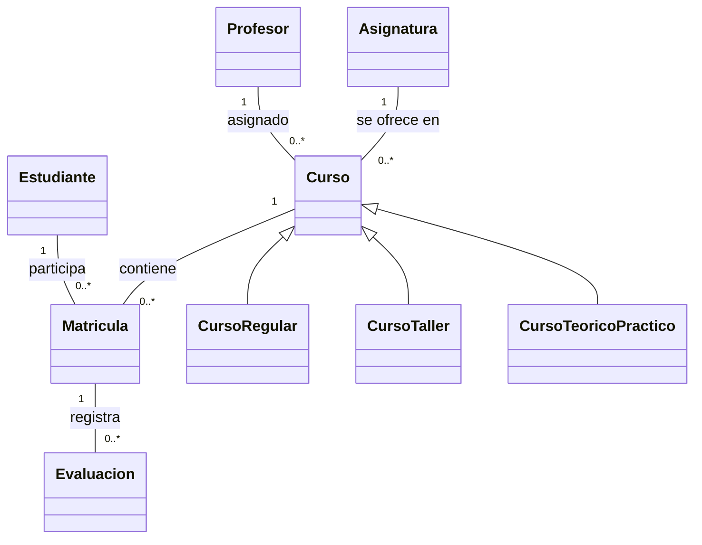

# Instituto Innova — Sistema de gestión de calificaciones

## Evaluación 1 · Corte 2

**Exposición: Enfoque Orientado a Objetos (EOO)**

| Dato | Información |
| --- | --- |
| Estudiante | José Javier Cuello Camargo |
| Profesor | Fernando Buelvas |
| Institución | Instituto Politécnico Santiago Mariño, Extensión Caracas |
| Caso | 7 — Sistema de gestión de calificaciones |
| Objetivo | Analizar y exponer el enfoque orientado a objetos desde un caso práctico. |

> **Estado del proyecto:** demostración funcional en C++ con interfaz web. Utiliza datos ficticios en memoria y roles simulados; no está diseñada para almacenar información académica real.

## Enlaces de entrega

- **Código y repositorio público:** [github.com/jjcuello/sistema-calificaciones-innova](https://github.com/jjcuello/sistema-calificaciones-innova).
- **Aplicación en Render:** [sistema-calificaciones-innova.onrender.com](https://sistema-calificaciones-innova.onrender.com).

## 1. Contexto del caso

La institución educativa **Instituto Innova** desea migrar su sistema de calificaciones, actualmente basado en hojas de cálculo y archivos sueltos, a una plataforma orientada a objetos.

El sistema debe permitir:

- Registrar estudiantes, profesores, cursos y asignaturas.
- Matricular a un estudiante en múltiples cursos.
- Asignar a cada curso un profesor, un horario y un aula, con un máximo de **40 estudiantes por sección**.
- Permitir que los profesores registren notas parciales, prácticas y exámenes finales.
- Calcular automáticamente el promedio ponderado: **20 % parciales, 30 % prácticas y 50 % examen final**.
- Soportar cursos regulares, cursos taller con evaluación **100 % práctica** y cursos teórico-prácticos.
- Generar reportes de rendimiento por estudiante, curso y semestre.
- Emitir alertas automáticas cuando el promedio de un estudiante sea **menor que 11**.
- Permitir que los estudiantes consulten sus notas en línea.
- Permitir que los administradores generen reportes consolidados por semestre y programa académico.

El equipo de desarrollo propone el EOO para representar las entidades del dominio, reutilizar comportamientos y facilitar el mantenimiento.

## 2. Parte 1 — Componentes principales del EOO

### Pregunta 1 — Clases y objetos

Una **clase** define el estado y el comportamiento de un tipo de entidad. Un **objeto** es una instancia concreta de esa clase, con identidad y valores propios.

Para este diseño, cada objeto de curso representa una **sección ofertada de una asignatura en un semestre**. Así, dos secciones de la misma asignatura pueden tener distintos profesores, horarios, aulas y matrículas.

| Clase | Atributos relevantes | Métodos propuestos | ¿Por qué es una clase y no un simple dato? |
| --- | --- | --- | --- |
| `Estudiante` | `id`, `nombre`, `programa` | `consultarNotas()`, `consultarPromedio()` | Tiene identidad, participa en matrículas y permite consultar información académica asociada; no se limita a almacenar un nombre. |
| `Profesor` | `id`, `nombre`, `especialidad` | `registrarNota()`, `estaAsignado()` | Representa a una persona con responsabilidades y operaciones propias sobre sus cursos. |
| `Curso` | `id`, `asignatura`, `profesor`, `horario`, `aula`, `semestre`, `matriculas` | `matricular()`, `registrarNota()`, `calcularPromedio()` | Agrupa información y reglas: controla el cupo, las matrículas y la evaluación de sus estudiantes. |

**Ejemplos de objetos con datos ficticios:**

- Un estudiante con identificador `1`, llamado Ana Pérez.
- Una profesora con identificador `1`, llamada María Torres.
- Un curso regular con identificador `1`, correspondiente a Programación orientada a objetos, semestre `2026-2`.

`Curso` es una clase base abstracta; los objetos concretos se crean como `CursoRegular`, `CursoTaller` o `CursoTeoricoPractico`.

**Entidades de apoyo:**

- `Asignatura`: identifica la materia del plan de estudios; no debe confundirse con su sección ofertada.
- `Matricula`: relaciona un estudiante con un curso y mantiene sus evaluaciones en ese curso.
- `Evaluacion`: representa una calificación y su categoría.
- Semestre y programa académico se representan como textos para organizar los reportes de esta demostración.
- `ServicioReportes`: reúne información del dominio para construir reportes sin mezclar esa tarea con la interfaz web.

La operación del profesor para registrar una nota delega en el curso correspondiente, sin duplicar la validación en ambas clases.



### Pregunta 2 — Encapsulamiento

**Clase seleccionada: `Curso`.**

#### Atributos privados

- **`matriculas`:** evita agregar estudiantes directamente, duplicar inscripciones o superar el límite de 40 estudiantes.
- **Evaluaciones almacenadas en cada matrícula:** evita modificar notas sin validar su valor, categoría, estudiante y profesor responsable. La protección debe mantenerse también dentro de `Matricula`.
- **`profesor`:** evita cambiar al responsable después de crear el curso mediante acceso directo al atributo.
- **`asignatura`, `semestre`, `horario` y `aula`:** evita modificaciones arbitrarias que dejen al curso en un estado inconsistente.

El máximo de **40 estudiantes** debe representarse como una constante de la regla de negocio, no como un valor modificable libremente desde la web.

#### Interfaz pública

| Método | Responsabilidad |
| --- | --- |
| `matricular()` | Comprobar que el estudiante no esté matriculado y que haya cupo antes de inscribirlo. |
| `registrarNota()` | Validar la matrícula, la categoría, el rango de la nota y la asignación del profesor antes de registrar la evaluación. |
| `consultarNotas()` | Entregar las evaluaciones de una matrícula sin exponer una colección modificable. |
| `calcularPromedio()` | Aplicar la regla de evaluación del tipo de curso. |

No se exponen listas modificables ni un método genérico que permita sobrescribir todo el estado. La selección de profesor en esta demostración es **simulada**: comprueba que el identificador corresponda al curso, pero no autentica a la persona. Para datos reales harían falta sesiones autenticadas y autorización en el servidor.

#### Beneficio de ocultar la implementación

La interfaz web puede solicitar una matrícula sin conocer cómo se almacenan internamente los estudiantes. Si posteriormente cambia la estructura de datos o la persistencia, el contrato público puede mantenerse.

Además, todas las entradas al sistema deberán respetar las mismas reglas. Por ejemplo, no será posible eludir el límite de cupos modificando directamente la colección de matrículas.

### Pregunta 3 — Herencia y polimorfismo

#### Clase principal: `Curso`

La clase base concentra:

- **Atributos comunes:** identificador, asignatura, profesor, horario, aula, semestre y matrículas.
- **Comportamientos comunes:** matricular estudiantes, controlar cupos, consultar matrículas y validar el registro de notas.
- **Contrato de evaluación:** `calcularPromedio()`, cuya implementación dependerá del tipo de curso.

En C++, el cálculo es un método **virtual puro**, las clases hijas lo implementan con `override` y la clase base tiene un **destructor virtual**.

#### Clases hijas

| Clase hija | Comportamiento específico |
| --- | --- |
| `CursoRegular` | Calcula el promedio con 20 % de parciales, 30 % de prácticas y 50 % de examen final. |
| `CursoTaller` | Calcula el promedio exclusivamente a partir de las prácticas; no exige parciales ni examen final. |
| `CursoTeoricoPractico` | En esta demostración usa la misma regla general: 20 % de parciales, 30 % de prácticas y 50 % de examen final. |

El enunciado no define una ponderación diferenciada para `CursoTeoricoPractico`; se acordó aplicar la regla general. Ambas clases reutilizan el mismo cálculo ponderado sin duplicar la fórmula.

#### Ejemplo concreto de polimorfismo

Un generador de reportes recorre cursos mediante referencias a la clase base `Curso` y solicita `calcularPromedio()` para una matrícula:

- Si el objeto es un `CursoRegular`, se ejecuta el cálculo ponderado.
- Si el objeto es un `CursoTaller`, se ejecuta el cálculo basado únicamente en prácticas.
- Si el objeto es un `CursoTeoricoPractico`, se ejecuta la regla general acordada.

El generador no necesita preguntar por el tipo de curso con una cadena de condiciones. La llamada es la misma, pero el comportamiento depende del objeto concreto.

**Ejemplo numérico:**

| Tipo de curso | Calificaciones | Resultado |
| --- | --- | --- |
| Regular | Parciales: 12; prácticas: 14; final: 16 | `12 × 0,20 + 14 × 0,30 + 16 × 0,50 = 14,6` |
| Taller | Prácticas: 14 | `14 × 1,00 = 14` |

## 3. Parte 2 — Análisis crítico

### Ventajas del EOO frente al enfoque estructurado

Un enfoque estructurado también puede resolver este problema y resultar rápido para un prototipo pequeño. La defensa del EOO no consiste en afirmar que las funciones sean incapaces de hacerlo, sino en justificar cómo se organizará un sistema con entidades relacionadas y reglas variables.

1. **Protección de reglas y consistencia de los datos.**  
   El curso controla sus matrículas y la asignación del profesor. Esto reduce el riesgo de que distintos formularios apliquen reglas diferentes o permitan un estudiante número 41. En un sistema real, la autorización también requiere autenticación.

2. **Reutilización y extensión de comportamientos.**  
   Los cursos regulares y los talleres comparten la gestión de profesor, horario, aula y estudiantes. Solo especializan lo que cambia: la evaluación. Un nuevo tipo de curso puede incorporarse sin reescribir el proceso de generación de reportes.

3. **Mantenimiento y pruebas por responsabilidad.**  
   El cálculo académico puede probarse sin abrir el navegador ni desplegar la aplicación. Si cambia una ponderación, se modifica la regla correspondiente sin alterar la presentación de notas o el registro de estudiantes.

**Conclusión:** el EOO se elige por su adecuación al dominio y a la evolución de sus reglas, no por una supuesta superioridad en velocidad de ejecución. Estos beneficios requieren un diseño disciplinado; usar clases por sí solo no los garantiza.

## 4. Reglas del caso y decisiones de la demostración

### Reglas explícitas del caso

- Máximo de **40 estudiantes por sección**.
- Un estudiante puede matricularse en varios cursos.
- Cada curso tiene un profesor asignado, un horario y un aula.
- Ponderación general: **20 % parciales, 30 % prácticas y 50 % examen final**.
- Los talleres se evalúan **100 % mediante prácticas**.
- El umbral de riesgo es **promedio < 11**; un promedio exactamente igual a 11 no está por debajo del umbral.

### Decisiones para esta implementación

| Tema | Decisión |
| --- | --- |
| Escala de notas | De 0 a 20. El enunciado fija el umbral de 11, pero no declara expresamente el rango. |
| Varias notas por categoría | Se calcula la media aritmética dentro de cada categoría y después se aplica su ponderación. |
| Precisión y límite técnico | Se admiten hasta seis decimales y 100 evaluaciones por categoría y matrícula; estos límites no están en el enunciado. |
| Evaluaciones pendientes | El promedio final permanece pendiente hasta completar las categorías requeridas; una nota ausente no se convierte en cero. |
| Cursos teórico-prácticos | Se aplica la ponderación general de 20 %, 30 % y 50 %. |
| Alertas | Se muestra una alerta en la web por cada promedio final de curso menor que 11. No se envían correos. |
| Redondeo | Se compara el promedio sin redondear contra 11; la presentación se redondea para facilitar la lectura. |
| Reportes consolidados | Se usa la media simple de los promedios finales disponibles y se excluyen los pendientes. |
| Almacenamiento y acceso | Los datos son ficticios, se mantienen en memoria y los roles son simulados. |

Estas decisiones no deben presentarse como requisitos adicionales dados por el profesor.

## 5. Solución técnica: C++ y Render

### Arquitectura

La aplicación tiene una interfaz web sencilla y una API en C++ con Crow. Se incluye un `Dockerfile` para alojarla como servicio web en Render.

```text
Navegador (HTML, CSS y JavaScript)
                 |
             HTTP / JSON
                 |
+--------------------------------------+
| Render: servicio web con Docker      |
|                                      |
|   API en C++ con Crow                |
|              |                       |
|   Modelo orientado a objetos         |
|              |                       |
|   Repositorio de datos               |
+--------------------------------------+
```

### Componentes

- **C++17 y CMake:** implementan y compilan el modelo y el servicio.
- **Crow:** capa HTTP; las rutas delegan en el modelo, sin duplicar las fórmulas.
- **HTML, CSS y JavaScript:** interfaz pequeña, servida desde el mismo servicio y sin un framework de frontend inicialmente.
- **Docker:** empaqueta la aplicación y sus dependencias para compilarla y ejecutarla en Render.
- **Render:** alojamiento del servicio web.
- **Datos ficticios en memoria:** se restablecen al cerrar o reiniciar el servicio.
- **Persistencia posterior:** evaluar SQLite con almacenamiento persistente, o una base de datos externa. No considerar el sistema de archivos del contenedor como garantía de conservación de datos.

### Estructura del proyecto

- [`src/modelo.hpp`](src/modelo.hpp) y [`src/modelo.cpp`](src/modelo.cpp): clases, cálculos y reportes. El archivo `.hpp` es un **encabezado de C++**: declara las clases y funciones que otros archivos pueden usar; el `.cpp` contiene sus implementaciones.
- [`src/servidor.cpp`](src/servidor.cpp): servidor HTTP y API.
- [`web/`](web/): interfaz en HTML, CSS y JavaScript.
- [`tests/`](tests/): pruebas del modelo y de la API.
- [`CMakeLists.txt`](CMakeLists.txt) y [`Dockerfile`](Dockerfile): compilación y empaquetado.

En este proyecto, por ejemplo, `modelo.hpp` declara clases como `Estudiante` y `Curso`, mientras que `modelo.cpp` implementa su comportamiento. El `.hpp` permite compartir esas declaraciones entre los distintos archivos fuente sin duplicarlas.

### Ejecutar localmente en Linux

En Ubuntu 22.04 o posterior, o Debian 12 o posterior, se necesitan Git, un compilador de C++17 y CMake 3.22 o posterior. CMake descarga Crow y Asio durante la primera configuración, por lo que se requiere conexión a Internet. Node.js 18 o posterior es opcional; permite ejecutar también las pruebas de la API.

Instalar las herramientas básicas:

```bash
sudo apt update
sudo apt install -y build-essential cmake git
```

Clonar el repositorio y entrar en su carpeta:

```bash
git clone https://github.com/jjcuello/sistema-calificaciones-innova.git
cd sistema-calificaciones-innova
```

Configurar, compilar y ejecutar las pruebas:

```bash
cmake -S . -B build/linux -DCMAKE_BUILD_TYPE=Release
cmake --build build/linux --parallel
ctest --test-dir build/linux --output-on-failure
```

Iniciar el servidor desde la carpeta raíz del proyecto:

```bash
./build/linux/innova
```

Abrir [http://localhost:8080](http://localhost:8080). Para detener el servidor, usar `Ctrl+C`. Si Node.js 18 o posterior no está instalado, se omiten las pruebas de la API; las pruebas del modelo siguen disponibles. Para instalar Node.js, seguir las [instrucciones oficiales](https://nodejs.org/en/download) y comprobar la versión con `node --version`.

### Ejecutar localmente en Windows

Se necesitan Git, CMake 3.22 o posterior y Visual Studio 2022 con las herramientas de C++. En la primera configuración, CMake descarga Crow y Asio. Node.js 18 o posterior permite ejecutar también las pruebas de la API.

Desde PowerShell, situado en la carpeta del proyecto:

```powershell
cmake -S . -B build\vs -G "Visual Studio 17 2022" -A x64
cmake --build build\vs --config Release
ctest --test-dir build\vs -C Release --output-on-failure
.\build\vs\Release\innova.exe
```

Abrir [http://localhost:8080](http://localhost:8080). Para detener el servidor, usar `Ctrl+C`. Si Node.js no está disponible, CMake informa que las pruebas de API se omiten; las pruebas del modelo siguen disponibles.

Con Docker instalado, también se puede ejecutar:

```powershell
docker build -t instituto-innova .
docker run --rm -p 8080:10000 instituto-innova
```

### Despliegue en Render

El servicio utiliza Docker, escucha en `0.0.0.0` en el puerto indicado por `PORT` y comprueba su disponibilidad mediante `/health`.

El repositorio está configurado como **Public Git Repository** con despliegue automático desactivado. Para publicar cambios:

1. Subir los cambios a la rama `main` en GitHub.
2. Abrir el servicio en el panel de Render y seleccionar **Manual Deploy → Deploy latest commit**.
3. Esperar a que el despliegue indique **Live** y verificar la aplicación.

El servicio gratuito puede detenerse después de 15 minutos sin actividad y tardar un minuto o más en responder de nuevo. Los cambios en memoria se pierden al detenerse, reiniciarse o desplegarse; los datos de ejemplo se cargan de nuevo al iniciar.

## 6. Cómo probar la demostración

1. En **Resumen**, revisar los datos de ejemplo y la alerta de Luis Mendoza.
2. En **Administración**, registrar un estudiante, un profesor o una asignatura ficticios.
3. En **Cursos y matrículas**, crear una sección y matricular estudiantes.
4. En **Registrar notas**, elegir al profesor asignado, el curso y el estudiante; añadir evaluaciones. Se acepta coma o punto como separador decimal.
5. En **Consulta del estudiante**, seleccionar una persona y revisar sus notas y promedio.
6. En **Reportes**, filtrar por semestre y programa para consultar los resultados consolidados.

Las vistas de estudiante, profesor y administrador son **simuladas** y públicas. No hay cuentas ni autenticación: cualquier visitante puede seleccionar un profesor o consultar los datos ficticios. Un sistema con información real requeriría autenticación, autorización y almacenamiento persistente.

### Casos de verificación

| Caso | Resultado esperado |
| --- | --- |
| Matricular al estudiante número 40 | Operación permitida. |
| Intentar matricular al estudiante número 41 | Rechazo explícito, sin modificar las matrículas existentes. |
| Matricular dos veces al mismo estudiante en una sección | Rechazo explícito de la matrícula duplicada. |
| Matricular al mismo estudiante en otra sección de otra asignatura | Operación permitida. |
| Curso regular con parciales 12, prácticas 14 y final 16 | Promedio 14,6. |
| Taller con práctica 14 y sin parciales ni examen final | Promedio 14. |
| Promedio 10,9 frente a promedio 11 | Alerta solo para 10,9. |
| Nota fuera del rango acordado | Rechazo explícito, sin sobrescribir una nota válida. |
| Falta una evaluación requerida | Resultado pendiente. |
| Profesor seleccionado que intenta registrar notas en un curso ajeno | Rechazo al no coincidir con el profesor asignado; esto no constituye autenticación. |
| Reporte de un semestre o programa específico | Incluye únicamente los registros del filtro y aplica la media acordada. |

Las pruebas automatizadas del modelo y la API cubren estos comportamientos, incluidos registros concurrentes para el límite de cupos.

## 7. Estado y próximos pasos

- [x] Modelar las clases, las relaciones y las reglas académicas en C++.
- [x] Incorporar la API, la interfaz y las pruebas automatizadas.
- [x] Preparar la imagen Docker.
- [x] Desplegar y verificar el servicio público de Render.
- [ ] Para un sistema real: incorporar autenticación y persistencia duradera.

## 8. Referencias técnicas

- [Crow: framework web para C++](https://crowcpp.org/master/).
- [Render: despliegues mediante Docker](https://render.com/docs/docker).
- [Render: configuración de servicios web](https://render.com/docs/web-services).
- [Render: limitaciones del plan gratuito](https://render.com/docs/free).
